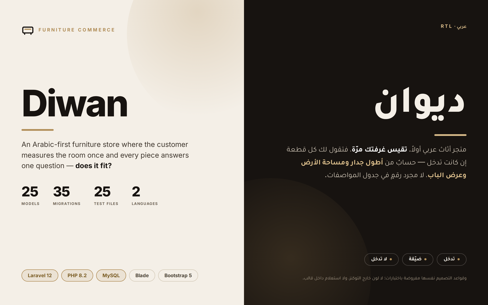

<p align="center">
  
</p>

# Diwan — ديوان

An Arabic-first furniture store. The customer measures a room once, and every
piece in the catalogue answers one question: **does it fit?**

---

## The idea

Furniture is the category where online shopping fails most often, and the reason
is dull: a sofa is 240 cm wide and the buyer has no idea whether 240 cm is fine.
The dimensions are printed in a specification table nobody can picture, so the
piece arrives and does not go through the door.

Diwan moves that question to the front. A customer saves a room with its width
and length, and from then on every product page gives a verdict against *that*
room rather than a number in a table.

---

## The part that matters

**The fit verdict is arithmetic with a rule set, not a hint.** A piece has to
fit the longest wall, take no more than half the floor, and have at least one
face under 80 cm so it clears a doorway. When more than one rule is broken the
customer is told the worst one, not the first one checked — dominating the floor
outranks a tight doorway. A room with no measurements returns `NO_ROOM`; a
product with missing dimensions returns `UNKNOWN`. The two are different answers
and the interface says so. Every verdict maps to its own icon, so the answer
never depends on colour alone.

**Stock is decided in the database, not in PHP.** Checkout locks the product row
with `lockForUpdate` inside the transaction that writes the order, so two
customers reaching for the last piece cannot both succeed — one gets the order,
the other gets a rejection, and a test proves it. A cart where one line is
unavailable fails whole: nothing is decremented, no order row survives.
Cancelling an order returns the stock exactly once, no matter how many times the
order is saved afterwards.

**Order history survives the catalogue.** An order line records what somebody
bought; the catalogue lists what is for sale today. Those were tied together
with `cascadeOnDelete`, so retiring a discontinued piece silently deleted it
from every past order — the totals stayed and the lines vanished. The columns
are now nullable and release instead of cascade, and `product_name_snapshot` and
`product_image_snapshot` carry the record. The id is only a link back for as
long as the piece is still on sale.

**The design system is enforced by tests, not by discipline.** A rule nobody
checks is a rule that drifts back, so the rules are unit tests over the Blade
templates: no colour outside `tokens.css`, no inline `style` unless the value is
computed at render time, no database query inside a template, no inline event
handler, every photograph through the `<x-picture>` component with a `sizes`
attribute, and an icon sprite that has to match the declared icon set exactly —
nothing declared and unused, nothing used and undeclared.

**A stylesheet that has to cover what it renders.** One test crawls nine pages,
collects every class the markup actually emits, and fails if any of them has no
rule in the built CSS — naming the pages that used it. A second test forbids
importing Bootstrap whole: the project pulls the grid, the utilities and four
components, and leaves roughly 100 KB of accordions and carousels on the floor.

**A content security policy with no escape hatch.** Every document response
carries a fresh nonce, `script-src` refuses both `'unsafe-inline'` and
`'unsafe-eval'`, and `default-src` is `'self'` with `object-src 'none'` and
`frame-ancestors 'none'`. That is only sustainable because there is no inline
JavaScript to allow — the design-system tests are what keep it that way. Fonts
are self-hosted rather than pulled from a third-party origin, so the policy has
nothing to open.

---

## By the numbers

| | |
|---|---|
| Eloquent models | **25** |
| Migrations | **35** |
| Test files | **25** — 22 feature, 3 unit |
| Public routes | **17** |
| Languages | **2** — Arabic and English, complete |
| Bootstrap components imported | **4** of the framework |

---

## Domain model

Twenty-five models across catalogue, purchase, customer and operations:

```
User          Profile        Role           Address
Category      Product        ProductImage   ProductVariant
Cart          CartItem       Order          OrderItem
Payment       Coupon         ShippingMethod Review
Wishlist      WishlistItem   Room           InventoryLog
ActivityLog   Notification   Contact        Session
NewsletterSubscriber
```

A product belongs to a category and carries images and variants; a cart holds
cart items; an order holds order items that keep their own name and image; a
room belongs to a user and gathers the wishlist items being considered for it.

---

## Tech stack

**Back end** — Laravel 12 · PHP 8.2 · MySQL · Laravel Sanctum
**Templating** — Blade, server-rendered
**Auth** — Laravel Breeze
**Front end** — Bootstrap 5.3 (partial imports) · SCSS · Vite 7 · vanilla ES modules
**Type** — self-hosted through `@fontsource`: IBM Plex Sans Arabic, Rubik, Bricolage Grotesque, Geist
**Localisation** — `lang/ar` and `lang/en`
**Quality** — Pest · Laravel Pint

No JavaScript framework. The storefront is server-rendered because a furniture
catalogue has to be crawlable and open quickly on a phone, and JavaScript does
progressive enhancement only — which is also what makes the strict CSP possible.

---

## What the tests cover

Checkout and stock under concurrency · order history and order mail · the fit
calculation and its severity ordering · the room board · admin access and guards
· registration, login, email verification, password reset and update · profile ·
static pages and error pages · SEO and structured data, including `InStock` and
`OutOfStock` following real availability · navigation query counts · the content
security policy and its nonce · stylesheet coverage · the design system rules.

---

## Running it

Requirements: PHP 8.2+ · Composer · MySQL · Node 20+

```bash
composer install
npm install && npm run build
cp .env.example .env && php artisan key:generate
php artisan migrate --seed
php artisan serve
```

```bash
php artisan test        # Pest
./vendor/bin/pint       # formatting
```

---

Built by [Ahmed Al-Hawajiri](https://github.com/ahmedalhawajri89), Gaza.
